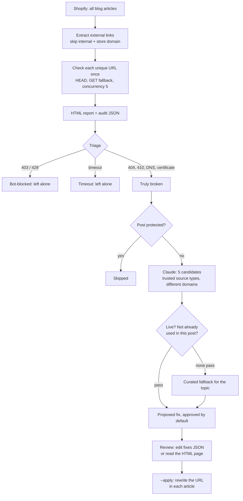

# Broken Link Audit: every outbound link in the blog checked, dead ones replaced with a verified live page

Two scripts for a Shopify blog. The first checks every external link in every article and writes a report. The second takes the links that are truly dead, finds a relevant replacement for each, confirms the replacement is live, and after review rewrites the links in place.

## The problem

Outbound links rot. A blog with a few hundred posts and several citations each will have dozens of links pointing at pages that have moved or disappeared. Readers hit dead ends, and a page full of broken citations looks unmaintained to search engines.

Finding them is the easy half. The harder half is that a checker's raw output is misleading: many "failures" are sites refusing automated requests, and those links work fine in a browser. Replacing them would make the content worse. And for the links that are dead, each one needs a replacement that covers the same subject, exists, and is not already cited in the same post.

## What it does

| Script | What happens |
|---|---|
| `src/audit-external-links.js` | Fetches every article, extracts external links with their anchor text, and checks each unique URL once (HEAD, then GET where HEAD is refused), several at a time. Writes a searchable HTML report grouped by post and a JSON file for the fixer |
| `src/fix-broken-links.js` | Phase 1: triages the audit, and for each truly broken link asks Claude for five candidate replacements, fetches them in order, and keeps the first that is live and not already used in the post. Writes the proposed fixes as JSON and as an HTML review page |
| `src/fix-broken-links.js --apply` | Phase 2: applies the fixes still marked approved in the JSON, replacing the broken URL inside each affected article |

## Architecture



## Key design decisions

**Broken and blocked are different things.** A 404, a 410, a DNS failure or a certificate error means the page is gone. A 403 or 429 usually means the site refuses automated checks, and the link works for a reader. Only the first group is replaced. Without this split the tool would swap out good citations.

**Suggested URLs are never trusted.** A language model will produce plausible links that do not exist. Every candidate is fetched before it can be used, and the first one that responds is taken. If all five fail, a curated list of stable pages for the topic is tried instead.

**No duplicate citations in one post.** The fixer tracks which replacement URLs each post already has and tells the model not to repeat them, then checks again itself.

**Top-ranking posts are protected.** Handles listed as protected in the config are audited and shown in the report, but never edited. A post that ranks well is not worth risking for a link fix.

**Internal links are out of scope.** Anything on the site's own host or the store domain is skipped at extraction.

**Find and apply are separate phases.** Phase 1 changes nothing in the store. Its output is a JSON file a person can edit: change a replacement, or set a fix to not approved. Phase 2 applies only what is still approved, and has its own dry run.

**Each URL is checked once.** Links are deduplicated across the whole blog before checking, with a concurrency limit and a timeout, so a citation used in forty posts costs one request.

**Resumable.** Phase 1 saves progress as it goes, and `--resume` continues after an interruption or a rate limit without paying for the same suggestions twice.

**Requests identify themselves.** Link checks carry a configurable client name.

## Repository layout

```
src/audit-external-links.js       link extraction, checking, HTML report, audit JSON
src/fix-broken-links.js           triage, replacement search, verification, apply
config/link-audit.example.json    protected posts, trusted sources, topics and fallbacks
scripts/test-links.js             offline tests for extraction, triage, topics and the prompt
```

## Setup

Requires Node 20+, a Shopify Admin API token with content read/write access, and an Anthropic API key for the replacement search.

```bash
npm install
npm test                                                   # offline, no keys needed
cp .env.example .env                                       # fill in values
cp config/link-audit.example.json config/link-audit.json   # your protected posts and topics
npm run audit                                              # report in ./output
npm run find                                               # propose replacements
# review output/broken-link-fixes.html, edit output/broken-link-fixes.json
npm run preview                                            # what --apply would change
npm run apply
```

| Variable | Purpose |
|---|---|
| `SHOPIFY_STORE`, `SHOPIFY_ADMIN_TOKEN`, `SHOPIFY_BLOG_ID` | Reading and updating blog articles |
| `SITE_URL`, `SHOPIFY_BLOG_HANDLE` | Telling internal links from external ones, and report links |
| `ANTHROPIC_API_KEY`, `CLAUDE_MODEL` | Replacement suggestions |
| `CLIENT_ID` | Client name sent with every link check |
| `CONFIG_DIR`, `OUTPUT_DIR` | Override the `config/` and `output/` locations |

A replacement that is live is not always the right citation. Read the review page before applying, especially for links that support a specific claim.

---

Extracted from a production automation suite I built and ran for a live e-commerce and B2B wholesale business, 2026.

© Michael Wootan. Source shared for portfolio review; all rights reserved.
